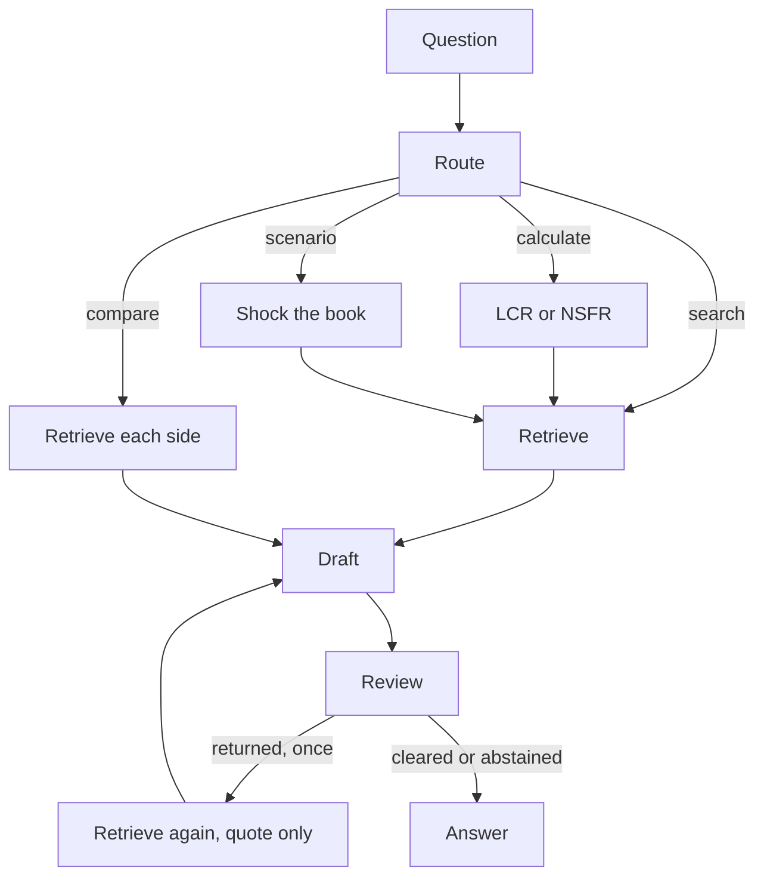

# Meridian

An agentic research desk for liquidity-risk regulation. It retrieves from a fixed corpus of supervisory briefings, calculates LCR and NSFR in Python, and releases an answer only after an independent review.

The public site is a recorded demonstration of that pipeline. The local server runs the pipeline itself.

## What a question can be

| Question | What the desk does |
| --- | --- |
| What is the LCR stress horizon? | Retrieves the briefing and answers from that passage. |
| HQLA = €12bn, outflow = €15bn, inflow = €5bn. What is the LCR? | Computes the ratio, including the 75% inflow cap. The model does not do the arithmetic. |
| What happens if stressed outflows rise by 20%? | Recomputes the book in Python, then reads the result against the rulebook. |
| Compare ECB ILAAP expectations with EBA stress-testing guidance. | Retrieves each side from its own sources before drafting. |
| According to ECB Regulation XYZ-999, what minimum LCR may a bank hold? | Names the missing instrument and abstains. |

## How an answer is produced



Routing lives in `meridian/agent.py`. A LangGraph graph selects the branch; if LangGraph is not installed, the same steps run in Python.

Drafting prefers an extractive composition whenever the question is a calculation, a scenario, a comparison, or a second pass after review. An OpenAI-compatible model is used only for ordinary research questions, and only when `OPENAI_API_KEY` is set. The reviewer still has to clear that draft. Without a key, every answer is assembled from retrieved sentences and the calculator narrative.

The reviewer checks four things: each statement is supported by a retrieved passage or the calculator narrative, every citation resolves to an indexed chunk, any stated ratio matches a fresh recalculation, and the draft does not attribute a rule to an instrument that is not in the corpus. A failed draft is returned once. If the second draft still fails, the desk abstains.

## Corpus

Nine analytical briefings in `corpus/`. They are notes on public standards, written so each claim can be retrieved and cited. They are not a substitute for the official text.

| Briefing | Authority |
| --- | --- |
| Liquidity Coverage Ratio — Framework | BCBS / European Union |
| High-Quality Liquid Assets | BCBS / European Union |
| LCR Net Cash Outflows | BCBS / European Union |
| Net Stable Funding Ratio | BCBS / European Union |
| ECB Guide to the ILAAP | European Central Bank |
| EBA Stress-Testing Guidelines — Liquidity | European Banking Authority |
| EU Liquidity Rulebook Map | European Union |
| Basel Liquidity Monitoring Tools | BCBS |
| Intraday Liquidity and Contingency Funding | BCBS / European Union |

Search is hybrid. BM25 and a dense index are scored together, then combined with lexical coverage of the question. Embeddings default to `BAAI/bge-small-en-v1.5` through FastEmbed, with FAISS when it is installed, and fall back to TF–IDF.

## Benchmark

`meridian/questions.py` holds 60 questions: factual lookup, multi-document questions, calculations, scenarios, comparisons, and adversarial questions that name instruments outside the corpus.

`meridian/evaluate.py` scores four systems on the same set.

| System | Behaviour |
| --- | --- |
| Closed book | Answers from a short memory and a deliberately incomplete ratio. Invents a rule for a missing instrument. |
| Basic RAG | BM25 only. No calculator and no abstention. |
| Hybrid RAG | Vectors plus the lexical reranker. No calculator and no abstention. |
| Agentic desk | Routes, calculates, cites, reviews, and abstains. |

Reported measures are recall@5, mean reciprocal rank, fact coverage, citation correctness, abstention correctness, and calculation accuracy. The Evaluation view on the site shows the latest local run of this bench. Those figures are measurements, not targets.

## Run it

```bash
python -m venv .venv
source .venv/bin/activate
pip install -r requirements.txt
uvicorn meridian.api:app --reload
```

Open [http://127.0.0.1:8000](http://127.0.0.1:8000). The first start downloads the embedding model into `data/models/` unless `MERIDIAN_EMBEDDING=tfidf`.

```bash
pytest
```

Tests force TF–IDF and unset `OPENAI_API_KEY`, so they do not call a model.

To score the full bench and write `data/last_eval.json`:

```bash
python -c "from meridian.evaluate import run_evaluation; run_evaluation()"
```

### Configuration

Copy nothing is required. Add a `.env` only if you want model drafting.

| Variable | Default | Role |
| --- | --- | --- |
| `OPENAI_API_KEY` | empty | Enables model drafting on ordinary research questions. |
| `OPENAI_MODEL` | `gpt-4o-mini` | Chat model sent to the completions endpoint. |
| `OPENAI_BASE_URL` | `https://api.openai.com/v1` | Any OpenAI-compatible base URL. |
| `MERIDIAN_EMBEDDING` | `auto` | `auto`, `fastembed`, or `tfidf`. |

### API

| Method | Path | Purpose |
| --- | --- | --- |
| `GET` | `/api/status` | Corpus size, embedding backend, whether a model key is present. |
| `GET` | `/api/presets` | Example questions, the sample policy, and the demo book. |
| `GET` | `/api/corpus` | Indexed briefings and their sections. |
| `POST` | `/api/ask` | `{ "question", "policy_text", "scenario" }` runs the desk. |
| `POST` | `/api/scenario` | Shocks the demo book and returns both ratios. |
| `GET` | `/api/eval/questions` | The 60-question bench. |
| `GET` | `/api/eval/latest` | Last saved evaluation, if one exists. |
| `POST` | `/api/eval/run` | Runs the bench and stores the report. |

```bash
curl -s http://127.0.0.1:8000/api/ask \
  -H 'content-type: application/json' \
  -d '{"question":"What is the LCR stress horizon?"}'
```

## Layout

```
corpus/            nine supervisory briefings
meridian/          desk, index, calculator, reviewer, evaluation, API
web/               static demonstration published on Netlify
tests/             calculator, retrieval labels, abstention, review
```

`web/` does not call the API. It replays representative traces: retrieved passages, tool calls, and the review record. `netlify.toml` publishes that directory only.

## Scope

Meridian answers from the indexed briefings and from deterministic formulas for the LCR, the 75% inflow cap, and the NSFR. It does not give legal advice, and an internal liquidity policy can be screened for gaps only when that policy text is supplied with the question.

Built by [Luoran Wu](https://www.linkedin.com/in/luoranwu).
